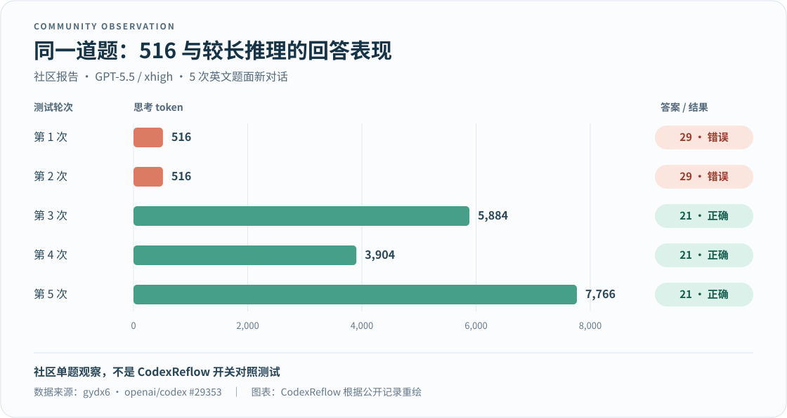

# CodexReflow · 续流

**为解决 GPT 模型的思维链截断问题而做，让没想完的推理接着往下走。**

GPT 经常只想了 `516` 个 token 就草草交卷？CodexReflow 是一个 [CLIProxyAPI](https://github.com/router-for-me/CLIProxyAPI)（CPA）插件，针对思考反复停在 `518n-2`（`516`、`1034`、`1552`……）的截断现象，自动接力推理，减少“还没想透就给答案”的情况。

当响应命中这类特征，且具备可用的上下文、上游推理状态和剩余续接额度时，插件会自动请求模型继续思考，再将多轮响应合并后返回客户端。

**项目来源：** 本项目基于 [uf-hy / CPA CodexComp v0.1.7](https://github.com/uf-hy/cpa-plugin-codexcomp/tree/v0.1.7) 独立维护，沿用源自 [dzshzx / codexcomp](https://github.com/dzshzx/codexcomp) 与 [neteroster / CodexCont](https://github.com/neteroster/CodexCont) 的续接机制与算法。

[English](README_EN.md) · [下载 v0.1.2](https://github.com/chatwithgod/cpa-plugin-codexreflow/releases/tag/v0.1.2) · [反馈问题](https://github.com/chatwithgod/cpa-plugin-codexreflow/issues/new?template=bug_report.md)

## 它能做什么？

- **自动接力思考**：识别 `518n-2` 等续接规则，满足条件时追加推理轮次、合并回答，不用手动催它“继续想”。
- **开箱即用**：新配置默认按名称自动匹配 GPT-5 及以上的标准文本模型，不用手写模型名单。
- **流式双协议支持**：支持 HTTP/SSE 与 WebSocket 数据流。

> **成本提示**：续接会消耗额外 token 并增加等待时间；实际增加多少推理、回答是否改善，因请求而异。

## 安装与使用

推荐直接在 **CPA / ECPA 插件商店**安装：

1. 打开「插件 → 插件商店」，搜索 **CodexReflow**。
2. 点击安装（版本留空默认安装最新发布版，也可手动填写 `v0.1.2`）。
3. 在本地插件列表中启用 CodexReflow，确认显示为“运行中”。
4. 像往常一样在客户端使用即可。**全新配置开箱即用，不需要手写 YAML，也不用配置模型名单。**

**使用提示**：

- 如果你之前使用过 CodexComp，请先停用它，避免两个插件同时接管同一模型。
- 更新插件版本前，建议先保留旧插件并备份现有配置，等待当前正在生成的回答全部结束。

手动下载 v0.1.2（点击展开）

按操作系统与架构下载对应压缩包：

| 平台 | 下载链接 |
|---|---|
| Windows x64 | [codexreflow_0.1.2_windows_amd64.zip](https://github.com/chatwithgod/cpa-plugin-codexreflow/releases/download/v0.1.2/codexreflow_0.1.2_windows_amd64.zip) |
| Linux x64 | [codexreflow_0.1.2_linux_amd64.zip](https://github.com/chatwithgod/cpa-plugin-codexreflow/releases/download/v0.1.2/codexreflow_0.1.2_linux_amd64.zip) |
| Linux ARM64 | [codexreflow_0.1.2_linux_arm64.zip](https://github.com/chatwithgod/cpa-plugin-codexreflow/releases/download/v0.1.2/codexreflow_0.1.2_linux_arm64.zip) |
| macOS Intel | [codexreflow_0.1.2_darwin_amd64.zip](https://github.com/chatwithgod/cpa-plugin-codexreflow/releases/download/v0.1.2/codexreflow_0.1.2_darwin_amd64.zip) |
| macOS Apple Silicon | [codexreflow_0.1.2_darwin_arm64.zip](https://github.com/chatwithgod/cpa-plugin-codexreflow/releases/download/v0.1.2/codexreflow_0.1.2_darwin_arm64.zip) |

下载后建议通过 [checksums.txt](https://github.com/chatwithgod/cpa-plugin-codexreflow/releases/download/v0.1.2/checksums.txt) 校验 SHA256。各平台的测试覆盖与已知限制见[兼容性说明](docs/COMPATIBILITY.md)。

## 为什么要解决“516 降智”？

“降智”说的是回答变差，但要分清两类问题：

- **路由降智**：请求被转给了另一个能力较弱的模型。
- **系统性降智（本文的通俗叫法）**：推理过程反复受限，模型还没想清楚就作答，导致表现下降。思维链截断是本项目着重处理的方向。

CodexReflow 针对后者：给疑似被提前截断的推理争取继续思考的机会，而不是换模型。插件不会验证上游的真实模型身份，也不负责修复模型替换。

### 社区测试里，差别有多明显？

在 [openai/codex #29353](https://github.com/openai/codex/issues/29353) 中，作者用 `gpt-5.5 / xhigh` 对同一道英文糖果数学题开了 5 次新对话：两次停在 **516 token** 的回答都错了，另外三次使用 **3,904–7,766 token** 的回答都答对了。

*图表根据社区作者 gydx6 的公开记录重绘。这是单题、五次样本的观察，不是 CodexReflow 的开关对照测试，也不是全模型正确率。*

这说明值得关注的不只是 token 数字，更是**推理没展开时，回答质量是否跟着下降**。更大规模的[社区统计 #30364](https://github.com/openai/codex/issues/30364) 也报告了固定 token 边界聚集，但作者明确保留了对内部截断机制的判断；这里把这些边界作为续接线索，而不是官方已确认的内部原因。

想在自己的环境里观察，可以参考 [haowang02 / codex-candy-eval](https://github.com/haowang02/codex-candy-eval/tree/29127fa5a12fb7654e865f684dcaf55ade181349)。该版本只测一道题，并以回答是否出现独立的 `21` 粗略判分，适合排查现象，不能代替综合能力评测。

## 默认规则与配置

**绝大多数用户直接使用默认设置即可，无需改动。**

| 设置项 | 默认行为 |
|---|---|
| **模型匹配 (`model_mode: auto`)** | 按请求名称自动匹配小写的标准 GPT-5 及以上文本模型（如 `gpt-6-astra`、`gpt-6-sol`、`gpt-6-luna`，支持路由前缀与推理后缀）。 |
| **追加次数 (`max_continue: 3`)** | 最多追加 3 轮；算上首轮，一次请求最多 4 轮。 |
| **自动排除模型** | 模型名称中若带有 `image`、`audio`、`realtime` 等非文本词段，会自动跳过不匹配。 |
| **诊断日志 (`debug_log: false`)** | 默认关闭详细调试；基础续接诊断依然正常记录。 |

**需要注意的事项**：

- 自动模式依据的是**客户端请求里的模型名称**，不会同步 CPA 的模型目录，也不会自动嗅探真实能力。像 `my-coder` 这样的自定义别名，必须在手动模式中填写。
- **旧配置升级**：如果原先只写了 `models` 名单、未指定 `model_mode`，升级后会继续保持旧名单行为；想要改用自动匹配，只需显式设置 `model_mode: auto`（此时旧 `models` 会被忽略）。
- 如需自定义排除、限制轮次或配置手动名单，请参考[配置说明](docs/CONFIGURATION.md)。

## 常见问题与排查

### 为什么用量记录里依然能看到 516？

续接不是把历史上的 516 改成别的数字，而是在首轮之后继续请求：

1. **首轮记录仍会保留**：CPA 可能分别记录首轮与续接轮。即使后续已经接着思考，首轮的 516 记录依然存在。
2. **续接不一定新增思考 token**：后续轮次可能增加推理，也可能直接给出回答，因此新增思考 token 仍可能为 0。

判断效果要看同一次请求有没有续接、最终是否完成，以及客户端收到的回答质量，不能只盯着单条 516 记录。

### 怎么判断插件是否真的触发了续接？

不要单看插件开关或者某一轮的 token 数。请查看同一次请求的续接日志：

1. 观察同一次请求是否记录了追加轮次；
2. 检查最后一轮是正常完成还是异常终止；
3. 确认客户端是否完整收到了回答（不要把“宿主已接受”误当成“客户端已送达”）。

具体日志指标与排查工具见[诊断说明](docs/DIAGNOSTICS.md)。

### WebSocket 连接能正常续接吗？

预热请求（`generate: false`）由 CPA 原生处理。`v0.1.2` 修复了空输入 `[]` 被改成 `null`、导致预热报 HTTP 400 的问题。

支持。但后续轮次的续接依赖完整可用的上下文、有效的上游加密推理状态，以及其余续接条件。如果上下文缺失、过期或超出了缓存大小，该请求可能不会续接。目前并非所有客户端或平台都做了全量验证。

### 遇到请求卡住或报错怎么办？

1. 先在 CPA 插件列表里临时停用 CodexReflow，用相同模型重新发一条消息。如果停用后恢复正常，把这一现象一并反馈，方便缩小排查范围。
2. 提交反馈时，请提供 CPA/ECPA 版本、插件版本、客户端名称及脱敏后的错误日志。
3. 请勿上传 API 密钥、账号凭证、完整配置文件或包含敏感信息的原始聊天记录。[前往反馈问题](https://github.com/chatwithgod/cpa-plugin-codexreflow/issues/new?template=bug_report.md)。

## 数据与隐私说明

为了将多轮回答正确拼合，插件会在本进程内存中临时缓存上下文与加密推理状态。

插件自身的默认诊断日志**不会记录**用户的提示词、模型回答、身份凭证或加密推理原文。CPA 宿主本身或并存的其他插件是否记录日志，取决于各自的配置。

## 更多文档

- [配置说明](docs/CONFIGURATION.md)：自动与手动模式、排除名单、轮次上限及旧配置升级。
- [诊断说明](docs/DIAGNOSTICS.md)：查看续接轮次、停止原因与用量统计。
- [兼容性与已知限制](docs/COMPATIBILITY.md)：测试覆盖范围、WebSocket 上下文条件及缓存限制。
- [开发指南](CONTRIBUTING.md) · [多平台编译](docs/MULTIPLATFORM.md) · [发布流程](docs/RELEASING.md) · [更新日志](CHANGELOG.md)

## 来源、致谢与许可证

CodexReflow 建立在以下开源项目的基础之上：

- **直接上游：[uf-hy / CPA CodexComp v0.1.7](https://github.com/uf-hy/cpa-plugin-codexcomp/tree/v0.1.7)**：本项目由此 CPA 插件直接 fork 并在其基础上独立维护，继承其 C ABI 桥接、配置管理、路由与 Go 续接实现。
- **算法来源：[dzshzx / codexcomp](https://github.com/dzshzx/codexcomp)**：上游 Go 版本的响应合并（fold）与续接逻辑移植自该项目的 `fold.py`。
- **机制来源：[neteroster / CodexCont](https://github.com/neteroster/CodexCont)**：原始的 `518n-2` 截断识别规则与加密推理状态重放机制。

感谢以上项目及其作者的贡献。CodexReflow 在此基础上进一步优化了 HTTP/SSE 与 WebSocket 兼容性、自动模型匹配与运行诊断，独立维护，非 OpenAI 或 CLIProxyAPI 官方项目。

本项目采用 [MIT 许可证](LICENSE)，保留原作者版权声明与许可文件。完整第三方来源与授权说明见 [THIRD_PARTY_NOTICES.md](THIRD_PARTY_NOTICES.md) 与 [THIRD_PARTY_LICENSES.txt](THIRD_PARTY_LICENSES.txt)。
