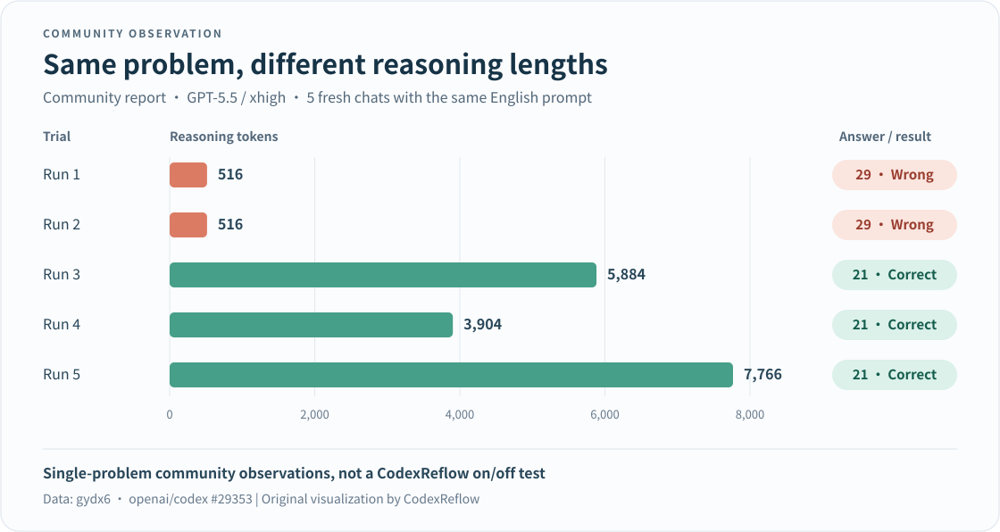

# CodexReflow

**Built to address GPT chain-of-thought truncation—give unfinished reasoning a chance to continue.**

Does GPT stop at `516` reasoning tokens and rush out an answer? CodexReflow is a [CLIProxyAPI](https://github.com/router-for-me/CLIProxyAPI) (CPA) plugin targeting the recurring `518n-2` pattern: `516`, `1034`, `1552`, and so on. It automatically requests more reasoning to help the model think a problem through instead of handing in an answer too soon.

When a response matches this pattern, usable context and upstream reasoning state are available, and the continuation limit has not been reached, the plugin requests another round and combines the responses for your client.

**Project origins:** Independently maintained fork of [uf-hy / CPA CodexComp v0.1.7](https://github.com/uf-hy/cpa-plugin-codexcomp/tree/v0.1.7), carrying forward continuation algorithms and mechanisms from [dzshzx / codexcomp](https://github.com/dzshzx/codexcomp) and [neteroster / CodexCont](https://github.com/neteroster/CodexCont).

[简体中文](README.md) · [Download v0.1.2](https://github.com/chatwithgod/cpa-plugin-codexreflow/releases/tag/v0.1.2) · [Report a problem](https://github.com/chatwithgod/cpa-plugin-codexreflow/issues/new?template=bug_report.md)

## What it does

- **Automatic reasoning continuation**: Applies continuation rules such as `518n-2`, requests further rounds when conditions are met, and combines the answer—no manual “keep thinking” messages.
- **Ready out of the box**: Fresh configurations automatically match standard GPT-5+ text model names without a handwritten model list.
- **Dual protocol streaming**: Supports both HTTP/SSE and WebSocket streams.

> **Cost note**: Continuation consumes extra tokens and increases wait time. Additional reasoning and any improvement in answer quality vary by request.

## Installation and use

The easiest way is via the **CPA / ECPA Plugin Store**:

1. Open **Plugins → Plugin Store** and search for **CodexReflow**.
2. Click **Install**. Leave the version blank for the latest release, or enter `v0.1.2`.
3. Enable CodexReflow in your local plugin list and confirm its status shows **Running**.
4. Use your client as usual. **Fresh installations require no handwritten YAML and no model list.**

**Important reminders**:

- If you were using CodexComp, disable it first so that both plugins do not handle the same models at once.
- Before updating versions, keep a copy of the previous plugin and configuration, and wait for ongoing responses to complete.

Manual downloads for v0.1.2 (click to expand)

Download the release archive for your operating system and architecture:

| Platform | Download link |
|---|---|
| Windows x64 | [codexreflow_0.1.2_windows_amd64.zip](https://github.com/chatwithgod/cpa-plugin-codexreflow/releases/download/v0.1.2/codexreflow_0.1.2_windows_amd64.zip) |
| Linux x64 | [codexreflow_0.1.2_linux_amd64.zip](https://github.com/chatwithgod/cpa-plugin-codexreflow/releases/download/v0.1.2/codexreflow_0.1.2_linux_amd64.zip) |
| Linux ARM64 | [codexreflow_0.1.2_linux_arm64.zip](https://github.com/chatwithgod/cpa-plugin-codexreflow/releases/download/v0.1.2/codexreflow_0.1.2_linux_arm64.zip) |
| macOS Intel | [codexreflow_0.1.2_darwin_amd64.zip](https://github.com/chatwithgod/cpa-plugin-codexreflow/releases/download/v0.1.2/codexreflow_0.1.2_darwin_amd64.zip) |
| macOS Apple Silicon | [codexreflow_0.1.2_darwin_arm64.zip](https://github.com/chatwithgod/cpa-plugin-codexreflow/releases/download/v0.1.2/codexreflow_0.1.2_darwin_arm64.zip) |

Verify SHA256 hashes against [checksums.txt](https://github.com/chatwithgod/cpa-plugin-codexreflow/releases/download/v0.1.2/checksums.txt). For platform coverage and known constraints, see the [compatibility notes](docs/COMPATIBILITY.md).

## Why address “516 degradation”?

“Degradation” describes worse answers, but two different problems are worth separating:

- **Routing downgrade**: A request is sent to a different, less capable model.
- **Systemic degradation (our informal term here)**: Repeated constraints on reasoning lead to answers before the problem has been properly thought through. Reasoning truncation is the specific problem this project targets.

CodexReflow focuses on the latter: giving potentially truncated reasoning a chance to continue, rather than switching models. It neither verifies the actual upstream model's identity nor fixes model substitution.

### What do community tests show?

In [openai/codex #29353](https://github.com/openai/codex/issues/29353), the author opened five fresh chats with `gpt-5.5 / xhigh` and the same English candy math problem. Both **516-token** runs answered incorrectly; the other three, using **3,904–7,766 reasoning tokens**, answered correctly.

*Original visualization of public observations reported by gydx6. These are five trials of one problem—not a CodexReflow on/off comparison or an accuracy estimate across models.*

The useful question is not just how many tokens were used, but **whether early stops coincide with worse answers**. A larger [community analysis, #30364](https://github.com/openai/codex/issues/30364), also reported clustering at fixed token boundaries, while explicitly stopping short of proving hidden reasoning truncation. We use those boundaries as continuation signals, not as an officially confirmed explanation of upstream internals.

To observe similar behavior in your own environment, see [haowang02 / codex-candy-eval](https://github.com/haowang02/codex-candy-eval/tree/29127fa5a12fb7654e865f684dcaf55ade181349). That version repeats one problem and grades answers by checking for a standalone `21`. It is a useful diagnostic probe, not a comprehensive intelligence benchmark.

## Default behavior and configuration

**Most users can run with defaults without modifying configuration.**

| Option | Default behavior |
|---|---|
| **Model matching (`model_mode: auto`)** | Matches lowercase standard GPT-5+ text model names (e.g. `gpt-6-astra`, `gpt-6-sol`, `gpt-6-luna`, including routing prefixes and reasoning suffixes). |
| **Continuation limit (`max_continue: 3`)** | Appends up to 3 additional rounds per request (maximum 4 total rounds including the initial request). |
| **Automatic exclusions** | Model names containing non-text segments such as `image`, `audio`, or `realtime` are automatically excluded. |
| **Diagnostics (`debug_log: false`)** | Detailed debug logging is disabled by default; essential continuation diagnostics remain active. |

**Key points**:

- Auto mode matches the **model name provided in the client request**. It does not sync CPA's model catalog or detect underlying model capabilities. Custom aliases like `my-coder` require manual list configuration.
- **Upgrading from older configs**: If your old configuration contains a `models` list without an explicit `model_mode`, upgrading preserves its legacy list behavior. To switch to automatic matching, explicitly set `model_mode: auto` (which ignores legacy `models`).
- For custom exclusions, round limits, or manual lists, see the [configuration reference](docs/CONFIGURATION.md).

## FAQ and troubleshooting

### Why do usage records still show 516?

Continuation does not replace a historical 516 entry with a different number. It requests another round after the first:

1. **The initial record remains**: CPA may record the initial and continuation rounds separately. A successful continuation does not remove the first round's 516 entry.
2. **More rounds do not always mean more reasoning tokens**: A follow-up may add reasoning or proceed directly to an answer, so it can add 0 reasoning tokens.

Look at the whole request: whether continuation happened, whether it completed, and the quality of the answer received by your client—not a single 516 entry.

### How do I verify that continuation actually happened?

Do not rely on the plugin switch status or a single token count alone. Check the logs for that specific request:

1. Did the request log any continuation rounds?
2. Did the final round complete normally or encounter an error?
3. Did your client successfully receive the combined output? (Host acceptance does not guarantee client delivery.)

For log fields and inspection tools, see the [diagnostics guide](docs/DIAGNOSTICS.md).

### Does WebSocket continuation work?

Warmup requests (`generate: false`) stay on CPA's native path. `v0.1.2` fixes empty input arrays `[]` being changed to `null`, which caused HTTP 400 during warmup.

Yes. Subsequent rounds require complete, available context and valid upstream encrypted reasoning state, along with the remaining continuation conditions. If context is missing, expired, or exceeds cache limits, that request may not be continued. Not all client and platform combinations have undergone full validation.

### What should I do if requests freeze or return errors?

1. Temporarily disable CodexReflow in your CPA plugin list and send a message with the same model. If normal behavior resumes, include that observation in your report to help narrow down the cause.
2. When reporting issues, include CPA/ECPA, plugin, and client versions alongside sanitized error logs.
3. Never post API keys, account credentials, full configs, or private chat histories. [Submit a report](https://github.com/chatwithgod/cpa-plugin-codexreflow/issues/new?template=bug_report.md).

## Privacy and data handling

To stitch consecutive rounds together, the plugin temporarily caches conversation context and encrypted reasoning state in local process memory.

Default diagnostic logs **never record** prompts, model outputs, credentials, or encrypted reasoning data. Logging behaviors in CPA itself or other third-party plugins follow their own separate configurations.

## Further reading

*Note: The configuration, diagnostics and development guides are currently written in Chinese.*

- [Configuration](docs/CONFIGURATION.md): Automatic vs. manual modes, exclusions, round limits, and legacy config migration.
- [Diagnostics](docs/DIAGNOSTICS.md): Tracking continuation rounds, stop reasons, and token usage.
- [Compatibility and limits](docs/COMPATIBILITY.md): Platform test coverage, WebSocket context requirements, and cache limits.
- [Development](CONTRIBUTING.md) · [Multiplatform builds](docs/MULTIPLATFORM.md) · [Releasing](docs/RELEASING.md) · [Changelog](CHANGELOG.md)

## Attribution, acknowledgments, and license

CodexReflow builds upon the contributions of these upstream projects:

- **Direct upstream: [uf-hy / CPA CodexComp v0.1.7](https://github.com/uf-hy/cpa-plugin-codexcomp/tree/v0.1.7)**: Directly forked and independently maintained, inheriting its C ABI bridge, configuration, routing, and Go continuation logic.
- **Algorithm source: [dzshzx / codexcomp](https://github.com/dzshzx/codexcomp)**: Upstream Go response folding and merging algorithms were ported from this project's `fold.py`.
- **Mechanism source: [neteroster / CodexCont](https://github.com/neteroster/CodexCont)**: Origin of the `518n-2` truncation detection heuristic and encrypted reasoning replay pattern.

Thanks to these projects and authors for their foundational work. CodexReflow adds improved HTTP/SSE and WebSocket handling, automatic model matching, and enhanced diagnostics. It is maintained independently and is not an official OpenAI or CLIProxyAPI project.

Released under the [MIT License](LICENSE), retaining original copyright and permission notices. Full third-party notices and licenses are documented in [THIRD_PARTY_NOTICES.md](THIRD_PARTY_NOTICES.md) and [THIRD_PARTY_LICENSES.txt](THIRD_PARTY_LICENSES.txt).
